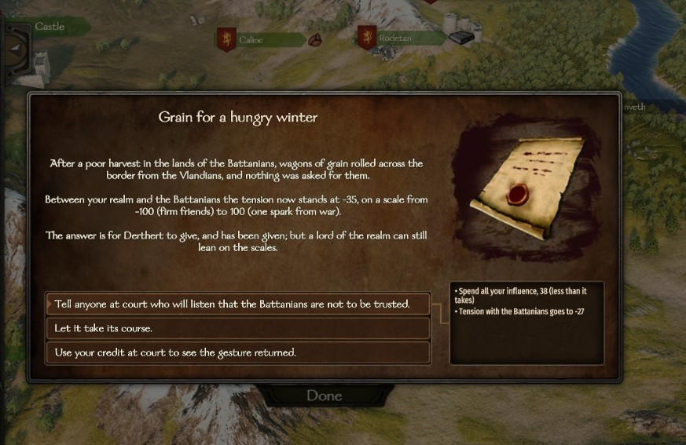

# Events between kingdoms

Neighbouring kingdoms that are not at war have things happen between them: a cattle raid, a seized caravan, a gift of horses, an oath of friendship. Each one pushes the two a little closer to war or further from it, so wars grow out of a story you can follow, and when your kingdom is involved, you get a say.

## Tension

Every pair of kingdoms has a **tension** that only recent incidents move. It starts at 0. In the game you see it as **grievances** (0 to 100: incidents that push toward war) or **goodwill** (0 to 100: incidents that hold war back), or **"no lasting mark"** when it is below 5 either way. It is only one of the things weighed when war is talked of: the rulers' relation, lost lands and the balance of strength count apart. Below, +100 means grievances 100 and -100 means goodwill 100.

- Grievances raise it, courtesies lower it.
- It fades on its own: it loses half of itself every 60 days.
- When two kingdoms make peace after a war, it goes back to 0. During the 45-day [truce](war-and-peace.md#truce-and-tribute) that follows, whatever builds up does not fade: it starts fading only once the two could go to war again.
- At +100 it is almost enough on its own to bring a war about. Below 0 it holds a war back in the same proportion.
- Above 0 it also counts as a **cause** for war, so a kingdom with no other quarrel no longer needs better odds once the tension is high enough (about 45) (see [War and peace](war-and-peace.md)).

## When events happen

Events only happen between two kingdoms whose lands touch and that are not at war with each other.

- **How often:** each pair has about one event every 33 days.
- **Many borders, not many more events.** A kingdom at peace with many neighbours would otherwise collect far more events than one with few. So each pair's chance is adjusted by how many neighbours at peace each of the two has, with 3 as the usual case: a kingdom at peace with 5 neighbours sees about 1.3 times the events of one with 3 (not 1.7 times), and one at peace with a single neighbour about half as many (not a third).
- **A long peace breeds incidents.** When neither kingdom is at war with anyone, events become more frequent once one of them has been at peace for 10 days, up to three times as frequent after 25 days.
- **When both are at war with other kingdoms,** events come half as often.

Which kind of event comes depends on how things stand:

| Situation | Grievances | Courtesies |
|---|---|---|
| Both at peace with everyone | 85% | 15% |
| One of them at war with a third kingdom | 25% | 75% |
| Both at war with third kingdoms | 50% | 50% |

Few will pick a quarrel with a kingdom that is fighting, or while fighting themselves.

## The events

Events come in three sizes, and they weigh a lot. Small ones move the tension by 35 (6 times in 10), medium ones by 80 (3 in 10), large ones by 100 (1 in 10): a single large grievance between two kingdoms with nothing between them takes them straight to grievances 100. The tension never goes past 100 either way. Which kingdom acted is a toss-up.

**Grievances** (raise the tension)

| Size | Event |
|---|---|
| Small | Cattle driven off |
| Small | Blows over a stag |
| Small | Tolls doubled |
| Medium | A caravan seized |
| Medium | A fugitive made welcome |
| Medium | An envoy slighted |
| Medium | One village, two lords |
| Large | Blood on the border |
| Large | A knife in the hall |

**Courtesies** (lower the tension)

| Size | Event |
|---|---|
| Small | A gift of horses |
| Small | A fair on the border |
| Small | Fair words |
| Medium | Grain for a hungry winter |
| Medium | Captives sent home |
| Medium | The border walked |
| Large | Talk of a match |
| Large | An oath of friendship |

## How AI rulers react

Both rulers answer each event. An AI ruler **stirs it up** (a grievance counts 40% more, a courtesy 40% less), **lets it be**, or **smooths it over** (the reverse). Their choice depends on:

- their relation with the other ruler (a disliked ruler gets stirred against);
- their character: valorous rulers stir things up; merciful and calculating ones calm them down;
- whether they already have a war elsewhere (then they calm things down);
- a fair bit of chance.

However the two rulers answer, one event never moves the tension by more than one and a half times its size.

## When it is your kingdom

When an event involves the kingdom you rule or serve, the game's own event window opens with the story, where things now stand, and up to three choices. As a mercenary you are only told.

The window says, for example, *"Your steward reckons that the recent incidents between your realm and the Vlandians have left grievances 42/100, and that they lean the realm considerably toward war."* ("a little" below 20, "considerably" from 20 to 49, "heavily" from 50), and reminds you that this is only one of the things weighed when war is talked of.

**As ruler** you answer instead of your kingdom's AI, and your answer weighs a lot: it moves the tension by a further 75% of what the event moved it.

| Choice | Grievance | Courtesy | Cost (small / medium / large event) |
|---|---|---|---|
| Toward war | "Make the (kingdom) answer for it, loudly." | "Receive it coldly: the (kingdom) want something." | Lose 2 / 5 / 10 relation with their ruler |
| Neither | "Let it take its course." | "Let it take its course." | Nothing |
| Toward peace | "Send (ruler) a gift and a soft word, and let it rest." | "Answer in kind, and send (ruler) a gift of your own." | Send 5,000 / 15,000 / 40,000 denars to their ruler |

**As a vassal** your ruler has already answered, but you can lean on the scales: your answer moves the tension by a further 25% of what the event moved it.

| Choice | Grievance | Courtesy | Cost (small / medium / large event) |
|---|---|---|---|
| Toward war | "Tell anyone at court who will listen that this cannot stand." | "Tell anyone at court who will listen that the (kingdom) are not to be trusted." | 15 / 40 / 100 influence |
| Neither | "Let it take its course." | "Let it take its course." | Nothing |
| Toward peace | "Use your credit at court to have it settled quietly." | "Use your credit at court to see the gesture returned." | 15 / 40 / 100 influence |

Hovering over a choice shows the cost and where things will stand afterwards, such as *"Recent incidents with the Vlandians afterwards: grievances 68/100"*. If you cannot pay the full cost, you pay all you have and the effect is smaller in proportion.

A choice that would change nothing is not offered: if the grievances or the goodwill are already at 100 that way, or you have no gold (as ruler, toward peace) or no influence (as a vassal) to pay with. If neither paid choice would change anything, no window opens; you only get the message.

After a window, the next one comes no sooner than 40 to 60 days later (an event that only brings a message does not start this wait). Events of your kingdom in between still happen, and you get a message such as *"... Recent incidents with the Sturgians: grievances 42/100."* If the window cannot open within 2 days (for example because you are in a battle), the event takes its course without you.

!!! tip
    As ruler, a cheap way to keep a strong neighbour off your back is to smooth over the small incidents. A gift of 5,000 denars to their ruler can undo most of a cattle raid.

Some affairs of your own kingdom, and some requests you grant when you [hold court](royal-court.md#holding-court), can also move the tension with a neighbour.

## How it leads to war

When a war grows out of the tension and nothing else weighs more, the attacking clan names the last incident: *"We have not forgotten the seizing of the caravan. The Vlandians must be made to answer for it."* When the incidents are not the main reason but still weigh at least a third as much, they are named after it: *"... And the seizing of the caravan is not forgotten either."*

On the kingdom screen your own lords may say *"the cattle raid on the border still rankles"* in favour of a war, or *"our two realms have been on good terms of late"* against one.

## Turn it off

In the [settings file](../settings.md), set `RealmEventsEnabled` to `false`: no events and no tension. Events also need `WarScoringEnabled` (see [War and peace](war-and-peace.md)); without it, they do not happen. Set `RealmTensionHoldsDuringTruce` to `false` and the tension fades during the truce too.
