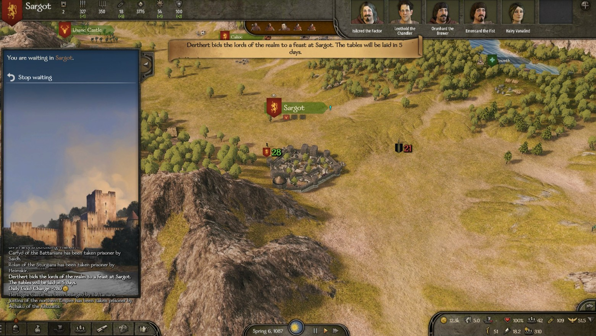
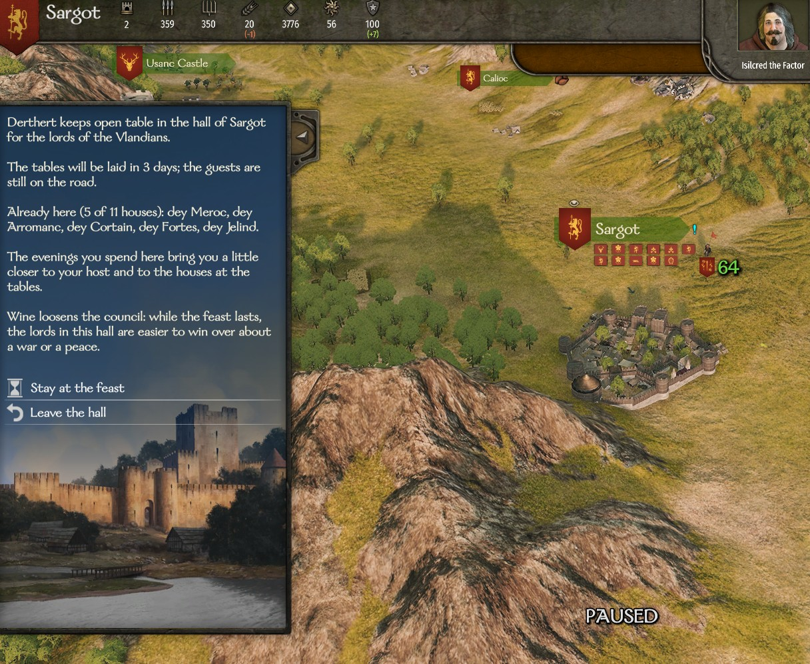

# Feasts and the grand tournament

In times of peace the lords of a kingdom gather under one roof. Houses grow closer or fall out, marriages are agreed, and you find the whole council in one hall, ready to be talked to. You can attend, hold feasts of your own and, as a ruler, add a grand tournament.

## When the AI holds a feast

- A kingdom must have been at peace with every other kingdom for **5 days**.
- Each day there is a **1 in 5** chance that one of its clans calls a feast.
- After a feast ends, that kingdom holds no other for **25 days**.
- The host is the ruling clan about **7 times in 10**. Otherwise it is one of the other clans, with higher-tier clans more likely.
- The host pays **1,500 denars for each clan invited**, and only calls a feast if they have three times that sum. They must be leading a party of their own and not be away with an army.
- The feast is held in the host's richest town. If they hold no town, it is held in one of their castles.

If the feast is in your own kingdom, a message on the map tells you who calls it and where: *"{Host} bids the lords of the realm to a feast at {place}. The tables will be laid in 5 days."*

## Notice, duration and who comes

- The tables are laid **5 days** after the feast is called, and the feast lasts **3 evenings**.
- Lords of the kingdom who lead a party ride there if they are within about **4 days** of travel and would arrive before it ends. The host comes from any distance. A lord with something more urgent to do, such as a siege, still does that.
- **Clan leaders without a party** who are idle in a town or castle also travel there, if they are within 4 days and would arrive with at least one evening left. Governors stay at their posts. Once at the feast, these lords stay until it is over.
- Mercenary clans are not invited.

## What happens at the tables

Every evening:

- The host grows a little closer to each clan sitting at the table (up to **+1** over the whole feast).
- Two of the houses present (never yours) are thrown together. Usually they part **1 point** closer. About **3 times in 10** they quarrel instead and lose **2 points**. If you are in the hall you see it: *"Hard words pass between … over the wine, and the hall goes quiet."*
- There is a **15%** chance that two unmarried lords of different clans in the hall agree a match and marry. The couple is picked by the game's own marriage odds. Nobody from your clan is ever married off this way.

Apart from your own feasts (see below), no feast raises a relation above **40**.

## War breaks it up

- If the kingdom goes to war with another kingdom, the feast ends at once: *"War has come: the feast at {place} breaks up and the lords ride back to their men."*
- A siege of the venue also ends it, and so does the host losing the venue or leaving the kingdom.
- If it is called off before the tables are laid, the host gets their money back and the feast does not count towards the 25-day wait.

## Attending as a guest

When a feast is being held in a town or castle you are in, the menu shows **Join the feast**. It takes you to the hall, which tells you who is hosting, how many days are left and which houses have arrived so far.

- **Stay at the feast** lets you wait in the settlement. **Leave the hall** takes you back.
- You count as present on any evening you are in the settlement.
- Stay for all 3 evenings and you gain **+1** with the host (if the host is there) and **+1** with one other house you spent the evening with.
- **Feasts of other kingdoms:** you can join if your faction is not at war with them and your relation with the host is **0 or better**. Otherwise the option is greyed out: *"{Host} keeps this table for friends, and does not count you among them."*
- **Easier persuasion:** at a feast of your own kingdom, the clan leaders in the hall are **one step easier** to win over about a war or a peace (see [Winning the council over](council.md)). Lords at the same feast are also easier to draw into a plot (see [Civil war](civil-war.md)).

## Holding your own feast

In a town or castle that belongs to your clan, the menu shows **Hold a feast here**. You need:

- to be in a kingdom (as a vassal or as ruler, not as a mercenary);
- your kingdom at peace with every other kingdom;
- no other feast of your kingdom already called;
- **8 days** since the last feast in your kingdom, whoever held it, and **25 days** since your own last feast;
- enough denars for at least the modest table.

If something is missing, the option is greyed out and the tooltip says why.

You choose one of three tables. The cost is paid for **each other clan of your kingdom** (mercenaries aside), whether or not it comes:

| Table | Cost per clan | Relation over the whole feast | Raises relations up to | Influence per clan per evening |
|---|---|---|---|---|
| A modest table | 1,500 | +1 | 30 | 0.3 |
| A generous table | 4,000 | +2 | 45 | 0.6 |
| A lavish table | 10,000 | +3 | 60 | 1.2 |

- The relation goes to each clan that sits through every evening, and **only if you preside in person** on those evenings. No relation goes above the limit for that table.
- When the feast ends you gain influence for every clan present on every evening you were there. For example, 10 clans for 3 evenings at a generous table gives 18 influence.
- **A host who is away gains nothing:** *"A feast without its host is soon forgotten: yours has won you nothing."*
- If war breaks out before the tables are laid, you get your denars back.

!!! tip
    Only a lavish table raises relations past 45, up to 60. Use the modest one when you just want the council in one room for persuasion.

## The grand tournament

A ruler can proclaim a **grand tournament of the realm** together with a feast held in a town (castles have no arena).

- **You, as ruler:** after choosing your table, a window asks *"A grand tournament?"*. Choose **Proclaim it** or **Just the feast**. It adds the purse of **20,000 denars** to the cost, so the window only appears if you can pay the table and the purse together.
- **Your AI ruler**, when you are a vassal: when they host a feast in a town and can afford it, they proclaim one about **half the time**.
- Only your own kingdom holds grand tournaments.

When the tables are laid, a tournament opens in the town's arena, with the lords who came to the feast on its lists. It lasts as long as the feast. You enter it at the arena as you would any tournament. If you do not fight it, the lords settle it among themselves on the last day.

The champion takes:

- **a prize of high-tier gear** (tier 5 or 6) of the kingdom's own culture: a weapon, a horse or a piece of armour;
- **a purse of 20,000 denars**, paid to the head of the champion's house;
- **50 renown** and **30 influence** (a normal tournament gives 3 renown and no influence).

When an AI lord wins, the game pays their clan the value of the prize in gold instead. Here that payment is capped at **100,000 denars**.

## The crowded hall

In the base game, every lord in a settlement goes into the lord's hall, even when the hall has no more places for them. Those left over all pile up at the door. With a feast in town this happens a lot.

With this mod, the hall only lets in as many lords as it has places for. The ones who come in are picked at random each time you enter. Your own clan, the feast's host, a lord you asked to speak to from the menu, a lord waiting for you at a meeting and lords needed by a quest always come in. The others are still in the settlement, and you can talk to them from the menu as usual. This applies to any crowded hall, not only during feasts.

## Turn it off

In the settings file (see [Settings](../settings.md)):

- `FeastsEnabled`: `false` turns off all feasts, for the AI and for you, and the grand tournament with them.
- `GrandTournamentEnabled`: `false` keeps the feasts but removes the grand tournament.
- `HallCrowdLimitEnabled`: `false` lets every lord into the hall again, as in the base game.
