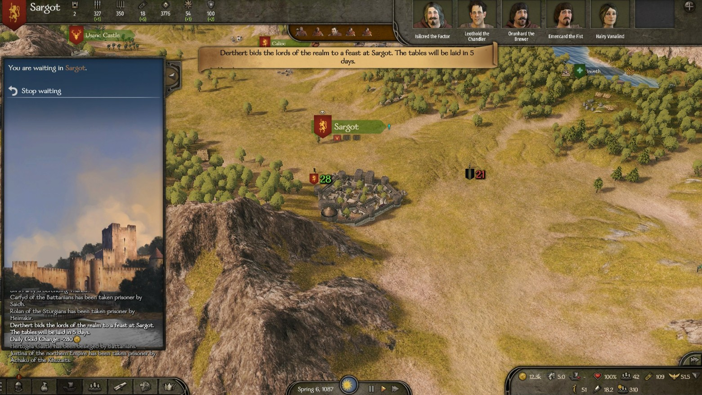
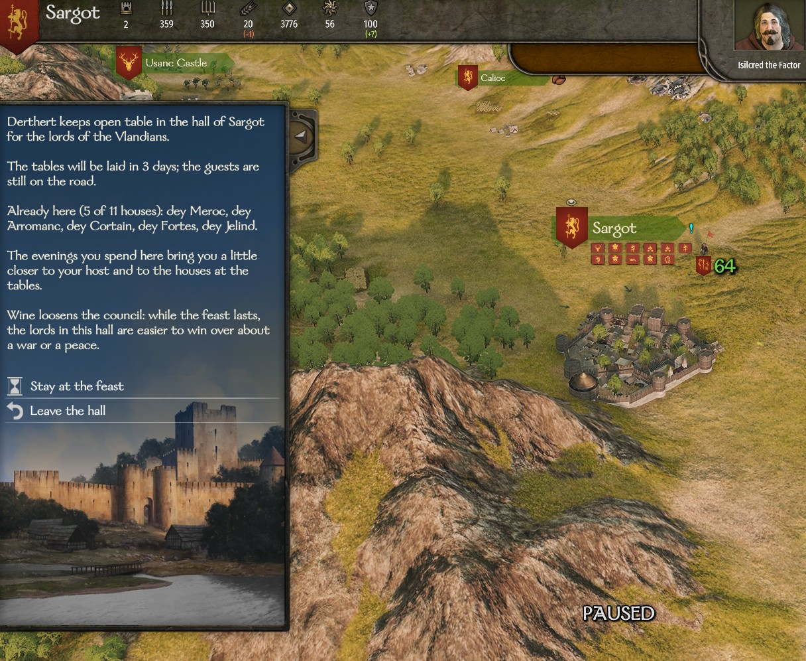

# Feasts and the grand tournament

In times of peace the lords of a kingdom gather under one roof. Houses grow closer or fall out, marriages are agreed, and you find the whole council in one hall, ready to be talked to. Every feast held in a town has a tournament in its arena, and a ruler's feast is the grand tournament of the realm. You can attend, and hold feasts of your own.

## When the AI holds a feast

- A kingdom must have been at peace with every other kingdom for **5 days**.
- Each day there is a **1 in 5** chance that one of its clans calls a feast.
- After a feast ends, that kingdom holds no other for **35 days**.
- The host is the ruling clan about **7 times in 10**. Otherwise it is one of the other clans, with higher-tier clans more likely.
- The host pays **1,500 denars for each clan invited**, and only calls a feast if they have three times that sum. They must be leading a party of their own, not be away with an army and not be on their way to your court.
- No feast is called while a [hunt](hunts.md) of the kingdom is announced or under way, nor in the **3 days** after it ends. AI hunts are normally fitted into the waiting time between feasts, so they rarely hold a feast back.
- Nor while the realm's [assembly](assembly.md) is summoned or sitting, nor in the **3 days** after it rises. An assembly that is only due holds no feast back: it waits for the feast instead.
- The feast is held in the host's richest town. If they hold no town, it is held in one of their castles.

If the feast is in your own kingdom, a message on the map tells you who calls it and where: *"{Host} bids the lords of the realm to a feast at {place}. The tables will be laid in 5 days."* A feast in a town also names its tournament and the champion's purse (see [The tournament of a feast](#the-tournament-of-a-feast)).

## Notice, duration and who comes

- The tables are laid **5 days** after the feast is called, and the feast lasts **3 evenings**.
- Lords of the kingdom who lead a party ride there if they are within about **4 days** of travel and would arrive before it ends. The host comes from any distance. A lord with something more urgent to do, such as a siege, still does that, and a lord you have called to your court (see [The royal court](royal-court.md)) goes there instead.
- When the tables are laid, a banner tells you if it is your own feast (*"Your feast at {place} has begun: join your guests in the hall."*) or a feast of your realm you are bidden to (*"The feast at {place} has begun: {Host} awaits the lords of the realm in the hall."*).
- **Clan leaders without a party** who are idle in a town or castle also travel there, if they are within 4 days and would arrive with at least one evening left. Governors stay at their posts. Once at the feast, these lords stay until it is over.
- Mercenary clans are not invited.

## What happens at the tables

Every evening:

- The host grows a little closer to each clan sitting at the table (up to **+1** over the whole feast).
- Two of the houses present (never yours) are thrown together. Usually they part **1 point** closer. About **3 times in 10** they quarrel instead and lose **2 points**. If you are in the hall you see it: *"Hard words pass between … over the wine, and the hall goes quiet."*
- There is a **15%** chance that two unmarried lords of different clans in the hall agree a match and marry. The couple is picked by the game's own marriage odds. Nobody from your clan is ever married off this way.

Apart from your own feasts (see below), no feast raises a relation above **40**.

## War breaks it up

- If the kingdom goes to war with another kingdom, the feast ends at once: *"War has come: the feast at {place} breaks up and the lords ride back to their men."*
- A siege of the venue also ends it, and so does the host losing the venue or leaving the kingdom.
- If it is called off before the tables are laid, the host gets their money back and the feast does not count towards the 35-day wait.

## Attending as a guest

When a feast is called or being held in a town or castle you are in, the menu shows **Join the feast**. It takes you to the feast's menu, which tells you who is hosting, how many days are left, which houses have arrived so far and what the tournament offers.

- **Stay at the feast** lets you wait in the settlement, with the menu kept up to date as the guests arrive. The wait stops by itself, with time stopped, when something opens for you: when the tables are laid (back to the feast), when the lists of its tournament open (back to the town, where the arena is; in a town both come in the same hour) and when the feast ends or breaks up. The game's own **Wait here for some time** in the venue also stops once, when the feast begins. **Leave the hall** takes you back.
- You count as present on any evening you are in the settlement.
- You gain **+1** with the host (if the host is there) for each evening you are there, **+3** over the whole feast. Stay for all 3 evenings and you also gain **+1** with one other house you spent the last evening with (*"You spend the evening in the company of the {clan}."*, also noted in the quest log).
- When the feast is over, its quest log entry names the houses you came closer to (*"You ride away on warmer terms with the {clans} than you came."*). At your own feast it tells you how many.
- **Feasts of other kingdoms:** you can join if your faction is not at war with them and your relation with the host is **0 or better**. Otherwise the option is greyed out: *"{Host} keeps this table for friends, and does not count you among them."*
- **Easier persuasion:** at a feast of your own kingdom, the clan leaders in the hall are **one step easier** to win over about a war, a peace or a fief (see [Winning the council over](council.md)). Lords at the same feast are also easier to draw into a plot (see [Civil war](civil-war.md)). A [hunt](hunts.md) gives the same help, but never on top of a feast.

## A word over the wine

Once the tables are laid, the town or castle menu (and the feast's) shows **Go to the lord's hall: the feast of {host}**, with how many houses sit at the tables and who they are. It takes you into the game's own hall, where the guests are. If the hall is closed to you, the option is greyed out with the game's own reason.

Speak to any lord of another house in the hall and choose *"A word, over the wine... (Feast)"*. He greets you by how he regards you and by his nature, and you can say:

- *"To your house, and to its health!"*: a toast to the head of a house of the feast's realm, **once a feast** for each. It brings you **+1** relation with him, never above 40. A lord who dislikes you drinks, but not with you, and nothing comes of it.
- *"What is being said at the tables tonight?"*: what the hall really talks of: two heads of house at the tables who can hardly bear each other, or two thick as thieves, and whether he himself is unhappy to see a house there. A lord who dislikes you tells you nothing; a quiet table has nothing worth repeating.
- *"Is there a match to be made between our houses?"*: only to the head of a house, and only when both houses have someone unwed. He tells you who of his house would suit whom of yours, by the game's own rules for a marriage, or that nobody would. If there is a match, *"Then let us speak of it in earnest."* takes you into the game's own marriage talk. A lord who dislikes you will not hear of it.
- *"There is a matter of war and peace I would raise with you."*: the [council's persuasion](council.md), with the feast's easier step: only with the head of a house of your own realm, and not while you serve as a mercenary. Landed knights have no vote, so it is not raised with them, nor by you if you are one.

## Holding your own feast

In a town or castle that belongs to your clan, the menu shows **Hold a feast here**. You need:

- to be in a kingdom (as a vassal or as ruler, not as a mercenary);
- your kingdom at peace with every other kingdom;
- no other feast of your kingdom already called, and no hunt of your kingdom announced or under way, nor one that ended less than **3 days** ago;
- no [assembly](assembly.md) of your kingdom summoned or sitting, nor one that rose less than **3 days** ago;
- **8 days** since the last feast in your kingdom, whoever held it, and **35 days** since your own last feast;
- enough denars for at least the modest table.

If something is missing, the option is greyed out and the tooltip says why.

You choose one of three tables. The cost is paid for **each other clan of your kingdom** (mercenaries aside), whether or not it comes:

| Table | Cost per clan | Relation over the whole feast | Raises relations up to | Influence per clan per evening |
|---|---|---|---|---|
| A modest table | 1,500 | +1 | 30 | 0.3 |
| A generous table | 4,000 | +2 | 45 | 0.6 |
| A lavish table | 10,000 | +3 | 60 | 1.2 |

- Your feast is **marked on your map** from the moment you call it until it ends or breaks up.
- The relation goes to each clan that sits through every evening, and **only if you preside in person** on those evenings. No relation goes above the limit for that table.
- When the feast ends you gain influence for every clan present on every evening you were there. For example, 10 clans for 3 evenings at a generous table gives 18 influence.
- **A host who is away gains nothing:** *"A feast without its host is soon forgotten: yours has won you nothing."*
- If war breaks out before the tables are laid, you get your denars back, the champion's purse too.
- In a town, a second window asks for the champion's purse (see [Your own feast's tournament](#your-own-feasts-tournament)).

!!! tip
    Only a lavish table raises relations past 45, up to 60. Use the modest one when you just want the council in one room for persuasion.

## The tournament of a feast

Every feast held in a town, in every realm, has a tournament in the town's arena, the AI's and yours alike. A castle has no arena, so a feast in a castle has only its tables. If the town already had a tournament of its own, it gives way to the feast's: there are never two.

- The lists open when the tables are laid, with the lords who came to the feast on them, and stay open as long as the feast. You enter at the arena as you would any tournament.
- If you do not fight it out, the lords settle it among themselves when the feast ends, or when it breaks up for any reason but a siege. A siege of the town takes the tournament down unfought.
- **The champion's purse.** The host puts up a purse for the champion when he calls the feast, besides the prize. An AI host puts up what he can spare, in whole thousands, and may put up none: then the champion fights for the prize alone. The purse never stops a feast. If nobody wins it, it goes back to the host.

### A lord's tournament

The feast of any host but the ruler has a tournament with the game's usual prize, and a purse of up to **5,000 denars**.

### The grand tournament of the realm

A ruler's feast in a town is always the **grand tournament of the realm**, in every kingdom. Its champion takes:

- **a prize of high-tier gear** (tier 5 or 6) of the kingdom's own culture: a weapon, a horse or a piece of armour;
- **a purse of up to 50,000 denars**, paid to the head of the champion's house;
- **50 renown** and **30 influence** (any other tournament gives 3 renown and no influence).

### Your own feast's tournament

When you hold a feast in one of your towns, a second window asks **What purse will you put up for the champion?**: none, or a quarter, a half, three quarters or all of the full purse (**50,000** for your grand tournament if you rule the realm, **5,000** otherwise); those you cannot pay on top of the table are greyed out. You pay it with the table. It goes to whoever wins (you, if you do), and back to you if nobody does.

### The prize of a champion away from you

When the champion is a lord of the AI, or one of your house who is not riding with you, the game pays his house the value of the prize in gold instead of the piece itself. Here that payment is capped at **100,000 denars**; if it is one of yours, you are told what the cap took off.

## The crowded hall

In the base game, every lord in a settlement goes into the lord's hall, even when the hall has no more places for them. Those left over all pile up at the door. With a feast in town this happens a lot.

With this mod, the hall only lets in as many lords as it has places for. The ones who come in are picked at random each time you enter. Your own clan, the feast's host, a lord you asked to speak to from the menu, a lord waiting for you at a meeting and lords needed by a quest always come in. The others are still in the settlement, and you can talk to them from the menu as usual. This applies to any crowded hall, not only during feasts.

## Turn it off

In the settings file (see [Settings](../settings.md)):

- `FeastsEnabled`: `false` turns off all feasts, for the AI and for you, and their tournaments with them.
- `GrandTournamentEnabled`: `false` keeps the feasts but removes the grand tournament: a ruler's feast then has a lord's tournament, or none if `FeastTournamentsEnabled` is off too.
- `FeastTournamentsEnabled`: `false` removes the tournament from the feasts of everyone but the ruler.
- `FeastHallTalkEnabled`: `false` removes the way into the hall and the words over the wine.
- `HallCrowdLimitEnabled`: `false` lets every lord into the hall again, as in the base game.
