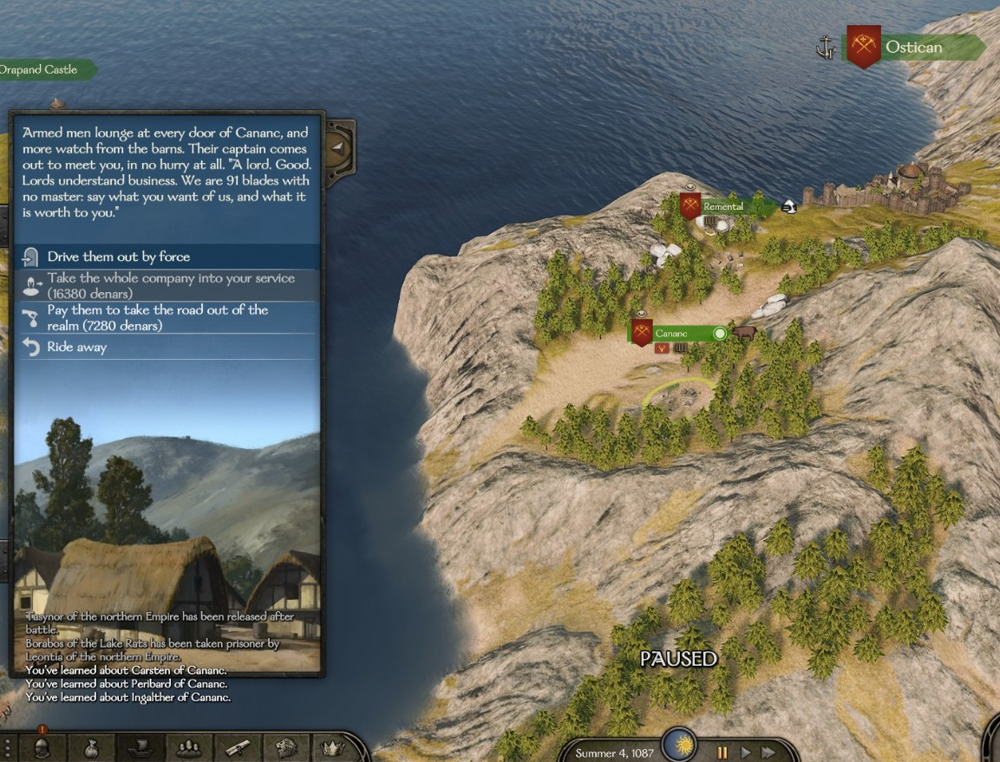

# Affairs of your kingdom

When your kingdom is at peace, trouble comes up inside it: a band of sellswords takes a village, peasants rise, a town starves, two houses feud, the crown wants to build, or a rival crown sends hired killers against your ruler. A messenger brings you the news, and you can ride there yourself, send someone in your name, or let it run its course. Each way ends differently.

## When they happen

- Only in the kingdom you **rule or serve as a vassal**. Mercenaries and AI kingdoms have none.
- Your kingdom must have been at peace with every other kingdom for **8 days**.
- A new affair comes up **25 to 35 days** after the last one came up. If the last one is still going on by then, the next comes the day after it is over.
- **One affair at a time**, never the same kind twice in a row. None starts while you are a prisoner.
- Feasts, hunts and petitions do not hold them back: they can fall in the same days.
- If the place stops being part of your kingdom, or you leave the kingdom, the affair simply ends.
- *The enemies of the crown* comes only to a **vassal**, never to the ruler.
- Apart from these affairs, a vassal is also asked to free the ruler when they are taken prisoner, in war as in peace: see [The crown in chains](#the-crown-in-chains).

**Ruler or vassal:** the affairs are the same, but some answers read differently, cost different amounts or carry more weight when you rule. The differences are given below.

## The messenger

Each affair reaches you through a messenger who stops you on the road and speaks to you on the map: *"Your pardon for stopping you on the road. I have ridden hard from {place}, and the news will not wait."* He waits until you are out on the map (not in a town, a battle, a siege, a menu or at sea).

**Until you have heard him, the affair stands still**: nothing happens and its time does not run, so you always get the full time from the moment you hear of it. He does not wait for ever: after **20 days** without reaching you (captivity counts), the affair runs its course as if you had let it be, and you are told: *"\"{title}\" was left to run its course while you could not be reached."* If you end the conversation without an answer, he tries again a few hours later.

You answer him as you answer someone who brings you a quest in the base game:

- the affair's own answers (ride there yourself, pay, judge...), described below;
- *"One of my companions or kin will see to it."* (see [Someone else sees to it](#someone-else-sees-to-it));
- *"My vassals will see to it."*, if you rule;
- and last, letting it be.

Answers you cannot afford are greyed out: *"You do not have the denars."* or *"You do not have the influence."* Hovering over an answer shows what it costs and gives. Places you have to go to are marked on the map.

If you hold an office in an AI ruler's court and the affair belongs to it, the messenger comes from the ruler (see [The ruler's charge](#the-rulers-charge)). The enemies of the crown always comes from the ruler: *"I ride from {ruler}."*

## In your journal

Once you have heard the messenger, the affair has its own entry in your quest log for as long as it lasts: *"Sellswords at {village}"*, *"The villages of {town} rise"*, *"Hunger in {town}"*, *"Bad blood: {first} and {second}"*, *"A work of the realm at {town}"*, or for the enemies of the crown the Blackhand job itself (for example *"Knives in the hall of {place}"*). It says what is happening, where, what can still be done about it and how much time is left, and it changes when your answer changes. The place is marked on your map while you are dealing with it yourself, and the rebel bands of a revolt carry an arrow on the map. A revolt has a bar of the bands broken, a famine a bar of the loads of grain handed over.

## A free company

A company of out-of-work sellswords has moved into a village of your kingdom. Your own villages are picked about half the time. The company has **40 + 15 × your clan tier + half the men in your party**, between **50 and 220** men. For example, a tier 3 clan with 100 men in its party faces 135 sellswords. While they stay, the village loses **0.5% of its hearths a day**, shown as **"Free company"** in its hearth breakdown.

| Answer | What happens |
|---|---|
| *"I will go to {village} myself."* | The village is marked. You have **30 days** to get there. |
| *"The village must fend for itself."* | After 5 days the company strips the village and leaves. |

**In the village.** If you took it in hand, entering the village opens the company's menu instead of the usual one:

- **Drive them out by force.** A battle in the village, just you and them. Mercenaries of the local culture, of every grade. Win and you get a bounty of **60 denars per sellsword**, **1 influence per 6 sellswords**, **+6** with the village notables, and **+5** with the village's owner if it is not yours. Lose and they still hold the village (if they capture you, you are let go at once), so you can come back before the time is up.
- **Take the whole company into your service** for **180 denars per man**. All of them join your party, whatever its size limit. **+3** with the village notables.
- **Pay them to take the road out of the realm** for **80 denars per man**. **+3** with the notables. They go to the lands of a neighbouring kingdom you are at peace with, and that kingdom will resent it: tension with it rises by 15 (see [Events between kingdoms](events-between-kingdoms.md)).
- **Ride away.**

For 135 sellswords: hiring costs 24,300, paying them off 10,800, and the bounty is 8,100.

**If the village is stripped** it loses 20% of its hearths. If it was your village, or you had said you would come, its notables lose **6** relation with you.

## The villages rise

Peasants around one of your kingdom's towns refuse their dues. The least loyal town is the most likely to rise. Up to **3 bands of rebels** appear on the map, one from each of its villages. Each band has 20 + 6 × your clan tier villagers (between 25 and 70), plus half as many militia footmen and a third as many militia archers. The AI lords leave them alone, because this is your affair. While bands are out, the town loses **0.3 loyalty** and **0.3 security** a day, shown as **"Peasant revolt"** in its breakdowns.

| Answer | What happens |
|---|---|
| *"Ride them down."* | The town is marked. You have **30 days**. |
| *"Forgive this year's dues and send them home."* (if you rule, or the town is yours) | Costs **2.5 × the town's prosperity** in denars (at least 4,000). The bands go home, the town gains **10 loyalty**, and the notables of all its villages gain **+4** with you. |
| *"Urge the lord of {town} to forgive this year's dues."* (vassal, someone else's town) | Same result for **40 influence**. |
| *"Let them shout themselves hoarse."* | The bands stay on the roads until someone breaks them or the time runs out. |

- **Each band you defeat** gives **12 influence**, **+3** with the town's owner (if it is not you), and **−3** with the notables of the band's home village.
- **All bands broken:** the town gains **5 loyalty**.
- **After 30 days** the revolt burns itself out: the town loses **3 loyalty** and **2% prosperity**.

## Hunger in a town

Blight takes the harvest of one of your kingdom's towns (yours about half the time). Its food stores are emptied and the grain in its market is gone. It needs **prosperity ÷ 25** loads of grain (between **80 and 300**), and the hunger lasts **25 days**. Every other day the town starves, with the loyalty and prosperity losses of any starving town in the base game.

| Answer | What happens |
|---|---|
| *"I will bring the grain myself."* | The town is marked. Bring the grain within **25 days**, in one trip or several. |
| *"Buy grain for them, whatever it costs."* | **45 denars per load** needed, and the hunger ends at once: **+8 loyalty**, **+4** with the notables, **+5** with the town's owner (if not you), **20 influence**. |
| *"They must tighten their belts."* | The town goes hungry. You can still bring grain later. |

To deliver, use the town menu option *"Hand over grain for the hungry (X of Y brought; you carry Z)"*. Once the full amount is in: **+12 loyalty**, **+8** with the notables, **+8** with the owner (if not you), **40 influence** and **8 renown**.

**If 25 days pass**, the town loses **5% prosperity** and **2 loyalty**. If it is your town, or you said you would bring the grain, its notables lose **3** with you. A siege of the town ends the famine.

## Bad blood

Two clans of your kingdom (never your own) start a feud. One of them usually picks the house it already likes least. Their leaders lose **15** relation with each other right away. Left alone, the feud runs its course after **12 days**.

| Answer | What happens |
|---|---|
| *"Write to both and bid them take each other's hand."* (ruler) / *"Offer yourself as go-between."* (vassal) | Costs **20 influence**. Chance of success: 35 + Charm ÷ 4 + (your relation with each of them) ÷ 4, **+25 if you rule**, or +25 if you are the Chancellor of an AI ruler, between 15% and 92%. The hint shows your chance. Success: **+25** between them, **+6** with you from each, **45 influence**. Failure: **−4** with you from each, and the feud runs on. |
| *"Send both houses your judgement."* (ruler) / *"Take a side."* (vassal) | The messenger asks whose part you take: *"For {name}."* (either of them) or *"On second thoughts, for neither."* |
| *"It is their quarrel."* | The feud runs its course. |

**Taking a side:** the winner gains **+12** with you. The loser loses **15** with you, and the loser's clan loses **40 renown and 40 influence** (60 each if you rule). The winner's clan gains **20 influence** (30 if you rule). The two leaders lose another **10** with each other.

**If the feud runs its course:** the two leaders lose another **15** with each other, each clan loses **25 renown and 25 influence**, and each leader loses a twentieth of their gold.

## A work of the realm

The crown wants to raise a building in a town of your kingdom (yours more often than not). It is always that town's least developed building that is below level 3. The work is finished or abandoned after **20 days**. It waits while the town is under siege.

| Answer | Cost (ruler / vassal) | Chance it is built |
|---|---|---|
| *"Give with an open hand."* | 30,000 / 20,000 | Certain |
| *"Give what is decent."* | 10,000 / 6,000 | Even odds |
| *"Not a coin: let those who want it pay for it."* | Nothing | About 1 in 7 |

If it is built, the building goes up **one level**. If you gave:

- **Open hand:** **60 influence**, **10 renown**, **+5** with the town's notables, and **+8** with your ruler if you are a vassal.
- **Decent:** **15 influence**, **+2** with the notables, and **+3** with your ruler if you are a vassal.

If it is abandoned, your money is not returned. The work of the realm cannot be handed to anyone else: only your money counts.

## The enemies of the crown

**Only while you are a vassal** (never as ruler, and never as a mercenary). A rival crown has paid a crew of the Blackhand Company to strike at your ruler: a kingdom whose ruler is on bad terms with yours, or one that made peace with your realm in the last 120 days. Without such a rival, this affair does not come up.

The messenger tells you what the killers mean to do, and adds that your ruler *"asks it of you, as one of the sworn lords of the realm, and not of a hired sword."*

| Answer | What happens |
|---|---|
| *"Tell {ruler} I will see to it myself."* | It goes into your journal, with where to go and the days you have. |
| *"I cannot be spared for this. The crown has other swords."* | **−2** with your ruler, and the affair ends. |

The job is one of the five ways of [the Blackhand's knives](lords-enemies.md): killers in your ruler's hall (your ruler rides to a castle or town of their house and waits there), an ambush in the lanes of a town, the Blackhand's champion in an arena, a crew squeezing a village of the realm, or a trap in a tavern. That page has every choice and fight.

- **Done:** a rider of the royal household brings **4,000 denars** and a letter. **+5** with your ruler, **3 renown**, **10 influence**.
- **Done the lesser way** (the crew bought off, the long way round, the duel lost): **2,000 denars**, half the renown and influence, no relation.
- **Failed, or out of time:** **−3** with your ruler.
- If your ruler is cut down in their hall, there is a small chance (1 in 20) that they die of it.
- It ends with no blame if you become ruler, leave the kingdom, or the crown passes to someone else.

Nobody else can be sent: your ruler asked you.

## The crown in chains

**Only while you are a vassal** (never as ruler, and never as a mercenary, who has [a rescue of their own](mercenary-contracts.md#the-rulers-rescue)). This is not one of the affairs above: it does not wait for peace or take an affair's turn, because a captured ruler cannot wait.

When your ruler lies in the **dungeon of an enemy town or castle** within a long ride of you (and reachable by land), the one who holds their house together meanwhile (their spouse, or else their eldest child, or the eldest lord of the house) sends a messenger about half a day after the capture. If the ruler is still carried by the enemy's party, or held out of reach, the house looks again every few days. If you are serving the ruler as their [squire](squire.md), you get the squire's rescue instead.

- **On the road**, the messenger speaks to you on the map: *"Tell {sender} I ride at once. I will bring her/him home."* or *"I cannot, not now. Tell {sender} my heart is with the house, but my men are needed elsewhere."*
- **In an army**, where no messenger can reach you, a letter comes instead, **"A letter from {sender}"**: *"Send word that you ride at once"* or *"Send word that you cannot"*.
- If the messenger cannot reach you for 10 days, they ride back, and come again later.

Accept and the journal opens **"The crown in chains: free {ruler}"**, with the place marked on your map, for **50 days**. If the enemy moves the ruler, you are told where, and the new place or party is marked. While the ruler is carried by sea, the days wait.

- **In a town:** get in and reach the cells (the game's own prison break), or take the town.
- **In a castle:** storm it with your own men, or ride with the host of the realm that does.
- While you are on it, the ruler almost never slips out on their own.

| How the ruler goes free | Reward |
|---|---|
| By your own hand: the prison break, a battle or assault you lead | **12,000** denars, **10 renown**, **40 influence**, **+10** with the ruler |
| The place falls, or the party holding them is beaten, under another's command, with you in the fight | 40% of each (at least +1 with the ruler) |

The ruler thanks you in their own voice. **There is no blame of any kind**: refusing, running out of time, being a prisoner yourself, the ruler going free another way (a ransom, a peace, an escape) or dying, or your leaving the realm all end it with nothing held against you: *"Nobody at court will hold it against you if it cannot be done."* You are asked once per captivity.

## Someone else sees to it

For the free company, the revolt, the hunger and the feud, you can tell the messenger that someone else will deal with it. After a list of names comes a confirmation, *"So be it."* or *"No, wait. Let me think again."*, and the messenger rides off with your answer.

### One of your companions or kin

*"One of my companions or kin will see to it."* lists everyone of your family and companions **riding in your party**. Each line shows the skill that counts, how many men they want, how many days the whole errand lasts and the risk. Those who cannot go are greyed out with the reason (wounded, a governor, leading a party of their own, already away on another errand...). Works as ruler or vassal.

- **Pick the men.** For the free company, the revolt and the grain, the game's troop screen opens (*"Men for {name} ({N} wanted)"*), as when you send a companion on one of the game's quests. Only healthy men, never more than are wanted, and your party always keeps at least 10. Sending fewer than wanted adds risk. Cancelling the screen takes you back to the answers. The bad blood needs no men.
- **Grain** costs gold: they take it with them when they leave, at the market price of your realm's other towns (never less than about 34 a load).
- **Going between feuding houses** costs the same 20 influence as going yourself.

### A house of your realm (if you rule)

*"My vassals will see to it."* lists the houses of your realm: *"{house} (relation N, N influence)"*, with a few words added when the house might refuse (for example *"will likely take it"* or *"will likely turn you down"*), then who it would send, with their skill, men, days and risk. The two feuding houses are not asked.

- The house sends one of its lords, **never its head**, preferably one who holds no office at court. That lord must be free in one of the house's own towns or castles, and takes soldiers from its garrison, which always keeps at least half its men (and never fewer than 40).
- **Influence:** **30** at relation 0 with its head, 0.3 less per point of relation (0.3 more per point below 0), between **10 and 50**. For example 15 at relation +50, 39 at −30. Paid only if the house accepts. The feud adds its own 20 influence on top.
- **A house may say no.** At relation 0 or better it always accepts. Below that the chance of refusal grows in a straight line, to certain at **−30** or worse (the list says in words how likely it is to accept). A refusal costs nothing: *"{head} of the {house} sends word that the house has other cares: it will not take the charge from you."* That house will not be asked again about this affair.
- If you have a [court](royal-court.md#the-offices), the holder of the office that fits the affair is listed first: the **Marshal** for the free company and the revolt, the **Steward** for hunger, the **Chancellor** for bad blood.

### Skill, men, days and risk

| Affair | Skill that counts (the better of) | Men wanted | Days of work |
|---|---|---|---|
| A free company | Tactics or Leadership | about 30% of the company | 8 |
| The villages rise | Leadership or Tactics | about 25% of the rebels still out | 10 |
| Hunger in a town | Steward or Trade | 10 escorts | 6 |
| Bad blood | Charm or Trade | goes alone | 6 |

- On top of the days of work comes the ride there and back. A less skilled envoy takes longer: skill 120 adds 2 days, 60 adds 4, 30 adds 8. Above 120, nothing.
- With a skill of **120** or more there is no risk. Below that, every 10 points add 5% risk, and more men are wanted. A very skilled envoy needs fewer men.
- Fewer men than wanted adds more risk (up to +50%). The risk is never above 90%.
- Some of the men sent die in the fighting, more with a weak leader.
- While they are away, the affair keeps doing harm (the village keeps losing hearths, the town keeps starving), but its time waits for them.
- Only one errand at a time. While someone is out, both ways of sending are greyed out: *"{name} is not back yet from the last errand; there is nobody else to send until then."*

### In the quest log

Everyone you send gets an entry in your quest log, as companions sent on the game's quests do: its title (*"The free company at {village}"*, *"The revolt around {town}"*, *"Grain for {town}"*, *"The feud of {first} and {second}"*), who went with how many men, about how many days the work and the whole journey take, and a **Return Days** bar. When the work is done the entry says how it went, and it closes by itself when they are back, with the bar full. With a house, the entry closes when its lord has gone home and the soldiers are back in their garrison.

### What it costs and gives

What you send others to do never brings you more than doing it yourself:

| Affair | If it goes well |
|---|---|
| A free company | The company is broken. With family or a companion: half the bounty (30 denars a sellsword), half the influence, +3 with the village notables. With a house: only the goodwill of the notables. |
| The villages rise | All bands are broken and the town gains 5 loyalty. With family or a companion: 6 influence per band. |
| Hunger in a town | The grain arrives, with the same result as buying it. |
| Bad blood | The two houses make peace (+25 between them). With family or a companion you get the 20 influence back and +3 with each head. |

A house that succeeds gains **25 influence** and its head thinks better of you (**+5**).

**If it fails**, the person comes back wounded and the affair still stands. The messenger comes again 3 days later, or once they are back if that is later, and you can choose again. The affair keeps its own time limit from when you first heard of it, with at least a week left. Of the grain, only 30% to 60% of what was missing gets through, and the gold is not refunded. A failed go-between costs −2 with each head.

## The ruler's charge

If you hold an office in an AI ruler's court, the affairs of that office come to you as the ruler's charge: the messenger rides from the ruler, and the affair says *"{ruler} charges you, as {office}, to see it done."*

- **Marshal:** the free company and the revolt pay half as much again. Leaving them undone when the time runs out costs **−5** with the ruler.
- **Steward:** for hunger, the crown pays half the grain, and leaving it undone costs −5.
- **Chancellor:** +25 to the chance of making peace between feuding houses.
- **Master of Works:** a work of the realm brings you twice the influence and twice the relation with the ruler.

If the messenger could not reach you because you were a prisoner, the ruler does not hold it against you.

## Turn it off

In the settings file (see [Settings](../settings.md)):

- `RealmAffairsEnabled`: `false` turns off all affairs of your kingdom.
- `RealmAffairFreeCompany`: the free company.
- `RealmAffairPeasantRevolt`: the peasant revolt.
- `RealmAffairFamine`: hunger in a town.
- `RealmAffairClanFeud`: the feud between two clans.
- `RealmAffairRealmWorks`: the work of the realm.
- `RealmAffairEnemies`: the enemies of the crown.
- `RealmRescueRuler`: no rescue of your captured ruler is asked of you as a vassal.
- `AffairDelegationEnabled`: no sending companions, kin or houses; only the affairs' own answers.
- `CourtChargeEnabled`: holding an office for an AI ruler does not turn its affairs into the ruler's charge.
- `RealmAffairQuestLogEnabled`: no journal entry for the affair itself.
- `AwayQuestLogEnabled`: no quest log entries for those you send away (this also covers [companion errands](companion-errands.md)).
