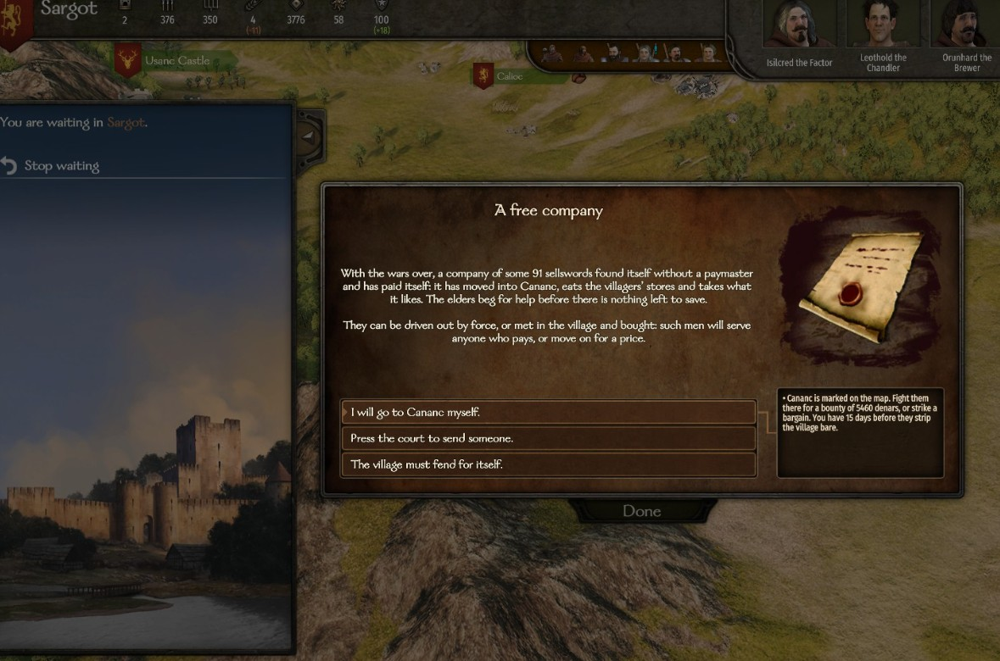
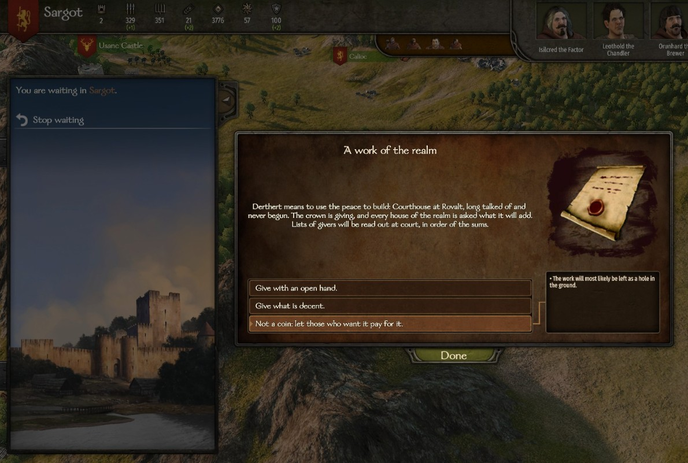

# Affairs of your kingdom

When your kingdom is at peace, trouble comes up inside it: a band of sellswords takes a village, peasants rise, a town starves, two houses feud, or the crown wants to build. Each affair can be taken in hand, entrusted to someone, or ignored, and each way ends differently.

## When they happen

- Only in the kingdom you **rule or serve as a vassal**. Mercenaries and AI kingdoms have none.
- Your kingdom must have been at peace with every other kingdom for **8 days**.
- Each day there is a **12%** chance that an affair starts.
- **One affair at a time**, never the same kind twice in a row, and none for **20 days** after the last one is settled.
- You are asked what to do in the game's event window. Places you have to go to are marked on the map.
- If you cannot pay for the choice you picked, you are told *"You do not have the means for it. The matter is left to take its course."*
- If the place stops being part of your kingdom, or you leave the kingdom, the affair simply ends.

**Ruler or vassal:** the affairs are the same, but some choices read differently, cost different amounts or carry more weight when you rule. The differences are given below. Every affair except the work of the realm can also be [entrusted to someone](#entrust-it-to-someone): as a vassal, to your family or companions; as ruler, also to the other houses of the realm.

## A free company

A company of out-of-work sellswords has moved into a village of your kingdom. Your own villages are picked about half the time. The company has **40 + 15 × your clan tier + half the men in your party**, between **50 and 220** men. For example, a tier 3 clan with 100 men in its party faces 135 sellswords. While they stay, the village loses about 1.5% of its hearths every day.

| Choice | What happens |
|---|---|
| *"I will go to {village} myself."* | The village is marked. You have **15 days** to get there. |
| *"Entrust it to someone."* | See [Entrust it to someone](#entrust-it-to-someone). |
| *"The village must fend for itself."* | After 5 days the company strips the village and leaves. |

**In the village.** If you took it in hand, entering the village opens the company's menu instead of the usual one:

- **Drive them out by force.** A battle in the village, just you and them. Mercenaries of the local culture, of every grade. Win and you get a bounty of **60 denars per sellsword**, **1 influence per 6 sellswords**, **+6** with the village notables, and **+5** with the village's owner if it is not yours. Lose and they still hold the village (if they capture you, you are let go at once), so you can come back before the 15 days are up.
- **Take the whole company into your service** for **180 denars per man**. All of them join your party, whatever its size limit. **+3** with the village notables.
- **Pay them to take the road out of the realm** for **80 denars per man**. **+3** with the notables. They go to the lands of a neighbouring kingdom you are at peace with, and that kingdom will resent it: tension with it rises by 15 (see [Events between kingdoms](events-between-kingdoms.md)).
- **Ride away.**

For 135 sellswords: hiring costs 24,300, paying them off 10,800, and the bounty is 8,100.

**If the village is stripped** it loses 40% of its hearths. If it was your village, or you had said you would come, its notables lose **6** relation with you.

## The villages rise

Peasants around one of your kingdom's towns refuse their dues. The least loyal town is the most likely to rise. Up to **3 bands of rebels** appear on the map, one from each of its villages. Each band has 20 + 6 × your clan tier villagers (between 25 and 70), plus half as many militia footmen and a third as many militia archers. The AI lords leave them alone, because this is your affair. Each day the revolt lasts, the town loses **1 loyalty** and **1 security**.

| Choice | What happens |
|---|---|
| *"Ride them down."* | The town is marked. You have **15 days**. |
| *"Forgive this year's dues and send them home."* (if you rule, or the town is yours) | Costs **2.5 × the town's prosperity** in denars (at least 4,000). The bands go home, the town gains **10 loyalty**, and the notables of all its villages gain **+4** with you. |
| *"Urge the lord of {town} to forgive this year's dues."* (vassal, someone else's town) | Same result for **40 influence**. |
| *"Entrust it to someone."* | See [below](#entrust-it-to-someone). |
| *"Let them shout themselves hoarse."* | The bands stay on the roads until someone breaks them or 15 days pass. |

- **Each band you defeat** gives **12 influence**, **+3** with the town's owner (if it is not you), and **-3** with the notables of the band's home village.
- **All bands broken:** the town gains **5 loyalty**.
- **After 15 days** the revolt burns itself out: the town loses **5 loyalty** and **5% prosperity**.

## Hunger in a town

Blight takes the harvest of one of your kingdom's towns (yours about half the time). Its food stores are emptied and the grain in its market is gone. Every day it stays hungry, it loses loyalty and people as any starving town does in the base game. It needs **prosperity ÷ 25** loads of grain (between **80 and 300**), and the hunger lasts **18 days**.

| Choice | What happens |
|---|---|
| *"I will bring the grain myself."* | The town is marked. Bring the grain within **18 days**, in one trip or several. |
| *"Entrust it to someone."* | Someone takes the grain there for you. See [below](#entrust-it-to-someone). |
| *"Buy grain for them, whatever it costs."* | **45 denars per load** needed, and the hunger ends at once: **+8 loyalty**, **+4** with the notables, **+5** with the town's owner (if not you), **20 influence**. |
| *"They must tighten their belts."* | The town goes hungry. You can still bring grain later. |

To deliver, use the town menu option *"Hand over grain for the hungry (X of Y brought; you carry Z)"*. Once the full amount is in: **+12 loyalty**, **+8** with the notables, **+8** with the owner (if not you), **40 influence** and **8 renown**.

**If 18 days pass**, the town loses **10% prosperity** and **4 loyalty**. If it is your town, or you said you would bring the grain, its notables lose **5** with you.

## Bad blood

Two clans of your kingdom (never your own) start a feud. One of them usually picks the house it already likes least. Their leaders lose **15** relation with each other right away. Left alone, the feud runs its course after **6 days**.

| Choice | What happens |
|---|---|
| *"Summon both and make them take each other's hand."* (ruler) / *"Offer yourself as go-between."* (vassal) | Costs **20 influence**. Chance of success: 35 + Charm ÷ 4 + (your relation with each of them) ÷ 4, **+25 if you rule** (another +25 if you are the Chancellor of an AI ruler), between 15% and 92%. The window shows your chance. Success: **+25** between them, **+6** with you from each, **45 influence**. Failure: **-4** with you from each, and the feud runs on. |
| *"Hear the case and give judgement."* (ruler) / *"Take a side."* (vassal) | A second window, *"Whose part?"*, lets you pick one of them, or neither. |
| *"Entrust it to someone."* | Someone goes between them for you. See [below](#entrust-it-to-someone). |
| *"It is their quarrel."* | The feud runs its course. |

**Taking a side:** the winner gains **+12** with you. The loser loses **15** with you, and the loser's clan loses **40 renown and 40 influence** (60 each if you rule). The winner's clan gains **20 influence** (30 if you rule). The two leaders lose another **10** with each other.

**If the feud runs its course:** the two leaders lose **30** with each other, each clan loses **50 renown and 50 influence**, and each leader loses a tenth of their gold.

## A work of the realm

The crown wants to raise a building in a town of your kingdom (yours more often than not). It is always that town's least developed building that is below level 3. The work is finished or abandoned after **10 days**. It waits while the town is under siege.

| Choice | Cost (ruler / vassal) | Chance it is built |
|---|---|---|
| *"Give with an open hand."* | 30,000 / 20,000 | Certain |
| *"Give what is decent."* | 10,000 / 6,000 | Even odds |
| *"Not a coin: let those who want it pay for it."* | Nothing | About 1 in 7 |

If it is built, the building goes up **one level**. If you gave:

- **Open hand:** **60 influence**, **10 renown**, **+5** with the town's notables, and **+8** with your ruler if you are a vassal.
- **Decent:** **15 influence**, **+2** with the notables, and **+3** with your ruler if you are a vassal.

If it is abandoned, your money is not returned. The work of the realm cannot be entrusted to anyone: only your money counts.

## Entrust it to someone

Instead of going yourself, you can send someone in your name. Choose *"Entrust it to someone."* in the affair's window and a list opens: **"Entrust it to someone"**. Each name shows the skill that counts, how many men they take, how many days the whole errand lasts and the risk that it goes wrong. Names you cannot pick are greyed out with the reason. If nobody at all can go right now, the option is not offered and the window says so.

**Who you can send**

- **Your family and companions** (ruler or vassal). They must be with you, in your party or in the same town or castle, and free: not wounded, not a governor, not leading a party of their own, not away on another errand. They take men from your party when the affair needs them, always leaving you at least 10.
- **The houses of your realm** (only if you rule). The house sends one of its lords, never its head, preferably one who holds no office at court, with soldiers from the garrison of the fief where that lord is staying. The garrison always keeps at least half its men. Asking a house costs **15 influence**.
- If you have a [court](royal-court.md#the-offices), the holder of the office that fits the affair is listed first: the **Marshal** for the free company and the revolt, the **Steward** for hunger, the **Chancellor** for bad blood.

**A house may say no.** If its head is on bad terms with you, there is a chance it refuses, from none at relation 0 to certain at **−30** or worse (about half at −15). You find out when you pick it, before paying anything: *"{Head} of the {house} sends word that the house has other cares: it will not take the charge from you."*

Only one errand at a time. While someone is out, the affair window tells you there is nobody else to send.

**Skill, men, days and risk**

| Affair | Skill that counts (the better of) | Men wanted |
|---|---|---|
| A free company | Tactics or Leadership | about 30% of the company |
| The villages rise | Leadership or Tactics | about 25% of the rebels still out |
| Hunger in a town | Steward or Trade | 10 escorts |
| Bad blood | Charm or Trade | goes alone |

- With a skill of **120** there is no risk and the work takes a few days. Below that, every 10 points add 5% risk, the work takes longer and more men are needed. A very skilled envoy needs fewer men.
- Fewer men than wanted adds more risk (up to +50%). The risk is never above 90%.
- Some of the men sent die in the fighting, more with a weak leader.
- While they are on the way, the affair keeps doing harm (the village keeps losing hearths, the town keeps starving), but it waits for them.

**What it costs and gives**

What you entrust never brings you more than doing it yourself:

| Affair | If it goes well |
|---|---|
| A free company | The company is broken. With family or a companion: half the bounty (30 denars a sellsword), half the influence, +3 with the village notables. With a house: only the goodwill of the notables. |
| The villages rise | All bands are broken and the town gains 5 loyalty. With family or a companion: 6 influence per band. |
| Hunger in a town | The grain arrives, with the same result as buying it. You pay for the grain at the market price, at least 45 a load. |
| Bad blood | The two houses make peace (+25 between them). Going between them costs 20 influence, as if you went; with family or a companion you get it back and +3 with each head. |

A house that succeeds gains **25 influence** and its head thinks better of you (**+5**).

**If it fails**, the person comes back wounded, the affair still stands, and it comes up again 3 days later with its full time. Grain that did not arrive is not refunded. A failed go-between costs −2 with each head.

**If you hold an office for an AI ruler,** the affairs of that office come to you as the ruler's charge: *"{King} charges you, as {office}, to see it done."* As Marshal, the free company and the revolt pay half as much again, and ignoring them costs **−5** with the ruler. As Steward, the crown pays half the grain and ignoring hunger costs −5. As Chancellor you get +25 to make peace between feuding houses. As Master of Works, a work of the realm brings you twice the influence and goodwill.

## Turn it off

In the settings file (see [Settings](../settings.md)):

- `RealmAffairsEnabled`: `false` turns off all affairs of your kingdom.
- `RealmAffairFreeCompany`: the free company.
- `RealmAffairPeasantRevolt`: the peasant revolt.
- `RealmAffairFamine`: hunger in a town.
- `RealmAffairClanFeud`: the feud between two clans.
- `RealmAffairRealmWorks`: the work of the realm.
- `AffairDelegationEnabled`: no "Entrust it to someone".
- `CourtChargeEnabled`: holding an office for an AI ruler does not turn its affairs into the ruler's charge.
